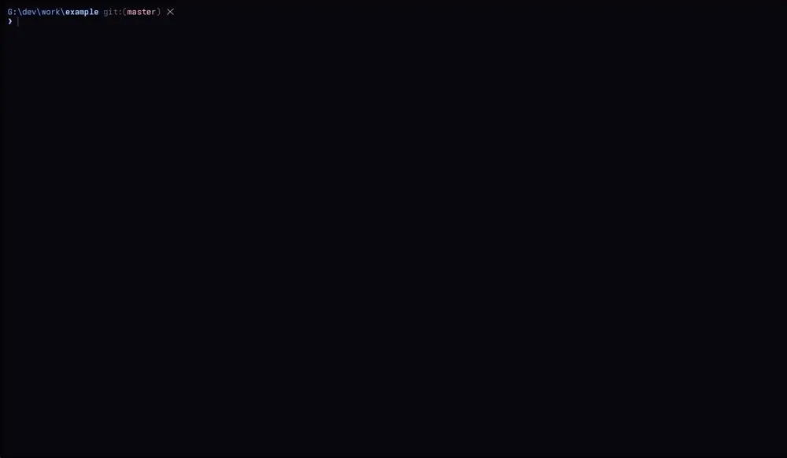

# sand

One command to run an AI coding agent inside a [Docker Sandbox](https://docs.docker.com/ai/sandboxes/).
`sand` wraps `sbx`: it finds or creates the sandbox, reconciles mounts and MCP
servers, copies your harness configuration in, keeps conversation history
across rebuilds, and logs every step and every `sbx` command it runs.

```console
$ sand codex . ../shared-lib:ro ../docs:rw
```



## Install

Requires the `sbx` CLI (signed in with `sbx login`).

Prebuilt executables for Linux, macOS and Windows are attached to every
[release](https://github.com/insertt/sand/releases). The install scripts
download the one for your platform and verify its checksum.

Linux and macOS (installs to `~/.local/bin`):

```console
$ curl -fsSL https://raw.githubusercontent.com/insertt/sand/main/install.sh | sh
```

Windows (installs to `%LOCALAPPDATA%\Programs\sand` and adds it to your `PATH`):

```console
PS> irm https://raw.githubusercontent.com/insertt/sand/main/install.ps1 | iex
```

Set `SAND_VERSION` (for example `v0.1.0`) to install a specific release instead
of the latest, and `SAND_INSTALL_DIR` to install somewhere else. Run the script
again to upgrade.

To build from source instead, with Rust 1.89 or later:

```console
$ cargo install --path .
```

## Usage

```text
sand [HARNESS] [MOUNT...] [FLAGS] [-- AGENT_ARGS...]
```

`HARNESS` is `claude`, `codex`, `opencode`, any other sbx agent, or one you
define in the config file. Without it, `default_harness` is used (`claude`
unless configured). Each `MOUNT` is a directory with an optional `:ro` or `:rw`
suffix (read-write by default). The first one is the primary workspace; with no
mounts, the current directory is used, so `sand codex` and `sand codex .` are
the same.

| Flag | Effect |
| --- | --- |
| `--mcp a,b` | Expose these MCP servers (names from `sbx mcp ls`). |
| `--resume` | Attach to the existing sandbox as it is, ignoring mounts on the command line. Fails if there is none. |
| `--no-attach` | Create or update the sandbox and start it, then exit without opening the agent. `sand [HARNESS] --resume` attaches later. |
| `--recreate` | Remove the sandbox and create it again. Conversation history is kept. |
| `--no-preserve-history` | With `--recreate`: discard the history too. |
| `--scratch` | No project: use the shared scratch directory, which persists and is shared by all harnesses. |
| `--dedicated-scratch` | No project: a throwaway mountless sandbox, removed when the agent exits. |
| `--name NAME` | Sandbox name. The default is `<harness>-<directory>`. |
| `--template T` | Create the sandbox from a template (see [Templates](#templates)). |
| `--acp` | Speak ACP on stdio instead of opening the terminal UI (see [Editors](#editors)). |
| `--install-editor zed\|jetbrains` | Register `sand [HARNESS] --acp` in the editor, then exit. |
| `--open-config` | Open the [config file](#configuration) in your editor, then exit. |
| `--on-conflict replace\|merge\|abort` | Answer the "sandbox exists with a different setup" question up front. |
| `-v`, `--verbose` | Echo every `sbx` command sand runs and show its output (otherwise shown only when a command fails). Works with the subcommands too. |

Other commands: `sand status [HARNESS] [DIR]` prints a sandbox's mounts, agent
API connectivity and MCP server status. `sand allow [HARNESS] [DIR]` opens the
network for hosts the sandbox was blocked from reaching (see
[Blocked network access](#blocked-network-access)). `sand template
build|save|ls|rm` manages templates.

### When the sandbox already exists

If the requested mounts, MCP servers or template differ from what the sandbox
has, `sand` shows both and asks:

- **Replace** makes the sandbox match the command exactly. Extra mounts are
  changed in place with `sbx mount` and `sbx umount`. A different primary
  workspace, a removed MCP server or a different template cannot be changed in
  place, so the sandbox is recreated (history is kept).
- **Merge** keeps what is there and adds what is missing.
- **Abort** changes nothing.

Adding MCP servers is never a conflict; they are attached live with
`sbx mcp load`. Without a terminal, pass `--on-conflict`. In `--acp` mode,
`sand` merges.

### One session per sandbox

`sand` holds an OS file lock for the sandbox while a session runs. A second
`sand` on the same sandbox, whether in a terminal or from an editor, fails
immediately and says who holds it. The lock is released if `sand` crashes.
Sessions started with plain `sbx run` are not detected.

## What sand sets up

**Bypass permissions.** Every session runs in the harness's bypass mode. `sbx`
adds the flag by default; `sand` also enforces it in the copied settings and
re-adds the flag when your agent arguments would replace sbx's defaults.

**Host configuration.** On every launch, `sand` copies your user-level harness
configuration into the sandbox: settings, global instructions, commands,
agents, plugins, hooks. Settings are merged in this order: what the
sandbox was created with, then your host settings, then sand's overrides.
Absolute paths that point into the copied directories (plugin install paths,
for example) are rewritten to their sandbox location. Files you delete on the
host are removed from the sandbox on the next launch.

Skills are not copied: `sbx` shares them through its own
[skills store](https://docs.docker.com/ai/sandboxes/workflows/agent-skills/),
mounted read-only in the sandbox. For Claude Code and Codex, `sand` runs
`sbx skills import --force` on every launch so the store matches the skills on
your host (set `import_skills = false` under `[harness.<name>]` to manage the
store yourself). A sandbox created before `sbx` had the store has to be
recreated (`--recreate`) to see it.

Not copied: credential files (`.credentials.json`, `auth.json`), `env` entries
in settings whose names look like credentials (use `sbx secret set`, or see
[Authentication](#authentication)), and MCP servers defined in the host
configuration (use `--mcp`).

**History.** Conversation history directories are backed by host directories
under sand's data directory and bind-mounted into the sandbox, so they survive
`--recreate` and even a manual `sbx rm`.

**Status.** For Claude Code, `sand` installs a status line with the sandbox,
the git branch, agent API and MCP server status, and below it the model, the
context window in use and how much of the 5-hour and weekly subscription limits
is spent:

```text
📦 claude-myproject │ ⎇ main │ API ✓ │ MCP atlassian ✓ gitlab ⚠ auth
🤖 Opus 5.5 │ ctx ████░░░░░░ 42% │ 5h 23% │ 7d 41%
```

Claude Code reports the limits only for Pro and Max subscriptions and only
after the first response of a session; until then that part is left out, as is
the branch outside a git repository.

Codex cannot run a status-line command, but it has a built-in status line, so
`sand` sets `tui.status_line` to show the model, git branch, context in use and
the 5-hour and weekly limits. To choose other items, set
`overlay = { tui = { status_line = [...] } }` under `[harness.codex]`. OpenCode
shows the model and context itself and has no limits to report.

The sandbox, API and MCP status cannot be added to the Codex or OpenCode
status line, so `sand` prints them as a banner before the agent starts, and
`sand status` shows them on demand.

| Harness | Config copied from | History kept | Status line | ACP command |
| --- | --- | --- | --- | --- |
| `claude` | `~/.claude` | `projects`, `todos`, `file-history` | yes | `npx -y @agentclientprotocol/claude-agent-acp` |
| `codex` | `~/.codex` | `sessions` | built-in + banner | `npx -y @agentclientprotocol/codex-acp` |
| `opencode` | `~/.config/opencode` | `~/.local/share/opencode` | banner | `opencode acp` |
| anything else | nothing | nothing | banner | set `acp_command` |

## Authentication

By default the agent uses whatever credentials `sbx` has for it (`sbx secret
set`, or the sign-in `sbx` offers). `auth` under `[harness.<name>]` selects
another way.

### Vertex AI

```toml
# config.toml
[vertex]
project = "my-gcp-project"
region = "global"                    # default

[harness.claude]
auth = "vertex"
```

Claude Code then runs against Vertex AI with a Google Cloud access token it
never sees. On every launch `sand`:

- registers the token as an `sbx` custom secret of that sandbox: `sbx secret
  set-custom --sandbox <name> --host <vertex hosts> --env ANTHROPIC_AUTH_TOKEN
  --command 'gcloud auth print-access-token' --refresh 45m`. The `sbx` daemon
  runs the command on the host and again once the cached token is 45 minutes
  old (Google's tokens last an hour), so sessions of any length keep working,
  including ones started with `--no-attach` or plain `sbx run`;
- sets `CLAUDE_CODE_USE_VERTEX=1`, `CLAUDE_CODE_SKIP_VERTEX_AUTH=1`,
  `ANTHROPIC_VERTEX_PROJECT_ID`, `CLOUD_ML_REGION` and `ANTHROPIC_AUTH_TOKEN` in
  the `env` of the sandbox's `settings.json`. `ANTHROPIC_AUTH_TOKEN` holds a
  placeholder (`sand-vertex-<sandbox>`); the sandbox proxy replaces it with the
  token on requests to the Vertex AI hosts;
- probes the Vertex AI host instead of `api.anthropic.com` for the API status.

`gcloud` has to be signed in on the host (`gcloud auth login`) and on the
`PATH` of the `sbx` daemon, and the Vertex AI host has to be allowed by the
sandbox's network policy (`sand allow claude --host aiplatform.googleapis.com:443`).
Other `env` entries, such as model overrides, go in
`overlay = { env = { ... } }`.

All `[vertex]` keys:

| Key | Default | |
| --- | --- | --- |
| `project` | required | Google Cloud project ID |
| `region` | `global` | Vertex AI region |
| `hosts` | from the region | hosts that receive the token: `<region>-aiplatform.googleapis.com` and `aiplatform.googleapis.com` |
| `token_command` | `gcloud auth print-access-token` | host command that prints a token; `sbx` runs it through the host shell from a temporary directory, so name helpers by absolute path |
| `refresh` | `45m` | how long `sbx` keeps a token: a duration, or `on-demand` to run the command for every request |

Only Claude Code has built-in Vertex AI wiring. For another harness, describe
it with `vertex_overlay` (settings merged in when `auth = "vertex"`; in
strings, `{project}`, `{region}` and `{host}` come from `[vertex]` and
`{token}` is the placeholder) and `vertex_token_env` (an environment variable
the agent gets the placeholder in). This works for any agent that sends a
bearer token it reads from its settings or environment, for example Gemini
models through Vertex AI's OpenAI-compatible endpoint in OpenCode:

```toml
[harness.opencode]
auth = "vertex"

[harness.opencode.vertex_overlay.provider.vertex]
npm = "@ai-sdk/openai-compatible"
name = "Vertex AI"
options = { baseURL = "https://{host}/v1/projects/{project}/locations/{region}/endpoints/openapi", apiKey = "{token}" }
models = { "google/gemini-2.5-pro" = {} }
```

It does not work for agents that sign in to Google themselves (Gemini CLI,
OpenCode's `google-vertex` providers): they exchange a credential file for
tokens, and that would have to be in the sandbox.

## Blocked network access

The sandbox's network policy rejects hosts that are not on an allow list.
`sand allow`, run in another terminal while the agent works, lists the hosts
the sandbox was blocked from reaching and lets you tick the ones to allow:

```console
$ sand allow claude                      # choose from the blocked hosts
$ sand allow claude --list               # only print them
$ sand allow claude --host zed.dev:443   # allow a host without asking
```

It reads `sbx policy log` and adds the rules with `sbx policy allow network
--sandbox <name>`, so they apply to that sandbox only; `--global` allows the
hosts for every sandbox. Hosts are allowed exactly as they were logged,
including the port. Requests that were blocked have already failed, so ask the
agent to try again. Blocks that an allow rule does not lift, such as an
explicit deny rule, are shown but not offered. A host you allowed stays in the
list until the sandbox reaches it.

## MCP servers

`sbx` owns the MCP registry. Register a server once with `sbx mcp add`, or
describe it under `[mcp.<name>]` in the config file and `sand` registers it the
first time you ask for it. A sandbox created with `--mcp` gets exactly those
servers (sbx static mode). A sandbox created without it lets the agent discover
registered servers through the gateway.

Before a sandbox starts, `sand` checks the servers it uses and runs
`sbx mcp auth <name>` for each one whose credentials are missing or expired.
`sbx` refreshes the credential on its own when it can and asks you to sign in
only when that needs your consent. A server that cannot be authorized is
reported and the launch continues without it. Without a terminal (and in
`--acp` mode) nothing is authorized; `sand` names the command to run instead.

## Templates

A template is an image with your tooling already installed. Three ways to get one:

```toml
# config.toml
[templates.rust]
dockerfile = "~/sand/rust.Dockerfile"   # built with `sand template build rust`
build_args = { RUST_VERSION = "1.90" }

[templates.corp]
image = "ghcr.io/acme/agent-image:3"    # pulled by the sandbox runtime
```

```console
$ sand template build rust            # docker build, then load into the sandbox runtime
$ sand template save claude-proj tuned   # or snapshot a sandbox you set up by hand
$ sand claude --template rust
```

Base a Dockerfile on the harness's sbx image, for example
`FROM docker/sandbox-templates:claude-code`. A Dockerfile template that has not
been built yet is built on first use. Set `template = "rust"` under
`[harness.<name>]` to make it that harness's default.

### Nightly images

`sbx` creates a sandbox from an image it already has, so the agent CLI inside
can be weeks old. To start from the image that is rebuilt every night with the
latest release of the harness instead:

```toml
# config.toml
nightly = true          # every harness…

[harness.codex]
nightly = false         # …except this one
```

`sand` then creates the sandbox with `--template docker.io/sbx/<agent>-image:latest
--pull always` (`docker/sandbox-templates:<agent>-docker-nightly` for `gemini`
and `shell`, which have no such image). A template, from `--template` or the
harness's `template`, takes precedence.

The image is fixed when a sandbox is created, so on every launch `sand` asks
the registry whether a newer build has been published since. If one has, it
offers to recreate the sandbox from it: history is kept, anything you installed
in the sandbox by hand is lost. Choosing to keep the sandbox is remembered
until the next build. `--on-conflict replace` recreates without asking and
`--on-conflict merge` keeps the sandbox; without a terminal, and in `--acp`
mode, the sandbox is kept and the log says a newer image exists. `--resume`
skips the check, and a registry that cannot be reached never blocks a launch.

## Editors

```console
$ sand claude --install-editor zed
$ sand codex --install-editor jetbrains
```

This adds an agent server entry that runs `sand <harness> --acp` (the previous
file is kept as `<file>.sand-backup`). The editor starts it in the project
directory, which becomes the primary workspace. In ACP mode stdout carries only
the protocol; sand's log goes to stderr.

On Windows the editor works with paths like `C:\Users\me\proj` while the agent
sees `/c/Users/me/proj`, so `sand` translates paths in the protocol stream in
both directions.

The first start of a new sandbox takes a while. If the editor times out, run
`sand <harness>` once in that project from a terminal.

## Configuration

`sand` reads `config.toml` from the platform config directory
(`~/.config/sand` on Linux, `~/Library/Application Support/sand` on macOS,
`%APPDATA%\sand` on Windows), or from `$SAND_CONFIG`. Everything is optional.
`sand --open-config` opens the file in `$VISUAL` or `$EDITOR` (creating it with
commented examples if there is none) and checks it when the editor closes.

```toml
default_harness = "codex"
nightly = true                       # use nightly harness images (see Templates)

# Change a built-in harness…
[harness.claude]
template = "rust"
exclude = ["node_modules"]           # names never copied, in addition to credentials
overlay = { model = "opus" }         # merged over the built-in settings overlay

# …or describe a new one.
[harness.aider]
agent = "shell"                      # sbx agent or kit to run
host_config_dir = "~/.aider"
sandbox_config_dir = ".aider"        # relative to the sandbox home
copy = ["conf.yml", "prompts"]
history = [".aider/history"]         # relative to the sandbox home
bypass_args = ["--yes-always"]
acp_command = ["aider", "--acp"]
api_check_url = "https://api.openai.com/v1/models"

[mcp.linear]
url = "https://mcp.linear.app/mcp"
```

All harness keys: `agent`, `host_config_dir`, `sandbox_config_dir`, `copy`,
`extra_copy`, `exclude`, `settings_files`, `settings_format`, `strip_keys`,
`overlay`, `history`, `bypass_args`, `statusline`, `acp_command`,
`api_check_url`, `template`, `nightly`, `import_skills`, `auth`,
`vertex_overlay`, `vertex_token_env`.

State lives in the platform data directory (`~/.local/share/sand`,
`~/Library/Application Support/sand`, `%LOCALAPPDATA%\sand`), or
`$SAND_DATA_DIR`: per-sandbox state and history, the shared scratch directory,
and session locks. `$SAND_SBX` overrides the `sbx` binary, and `$SAND_REGISTRY`
the registry asked about nightly images (a mirror's base URL).
